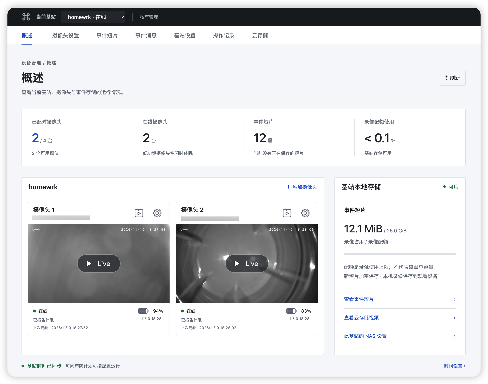
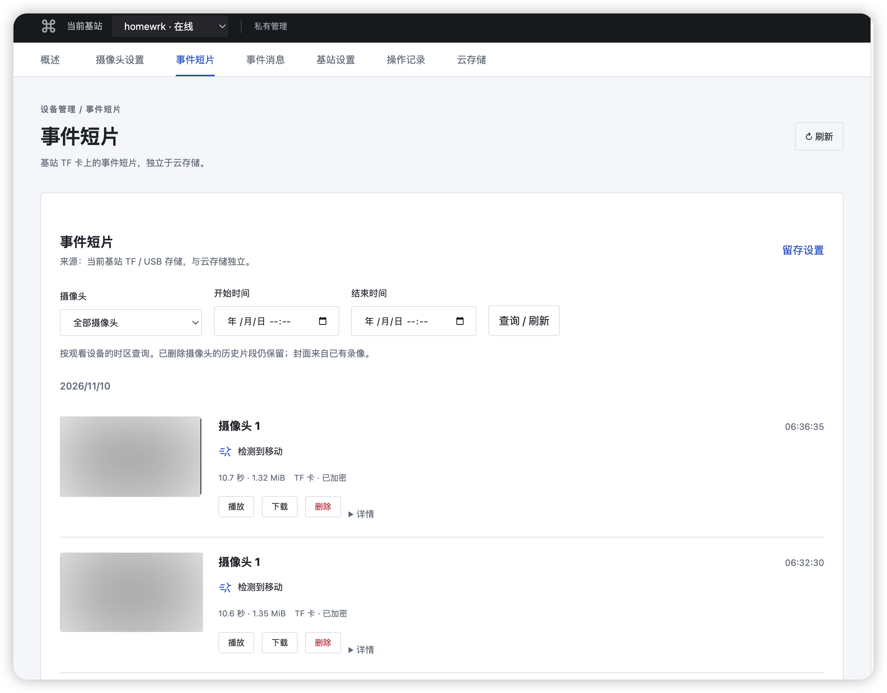

# VAVA Home

VAVA原厂停服，靠AI重新部署自己的服务。可舍弃原厂基站接入Openwrt无线路由器。

自有 VAVA 基站与摄像头管理系统。摄像头保留原厂固件；基站运行 `vava-agent`，通过专用 Wi-Fi 配对、控制低功耗摄像头并保存事件短片。独立的 `vava-server` 提供账户（未做全）、设备管理、实时观看、事件与云存储（未做），可以部署在小主机、NAS、性能足够的路由器或 Docker。

整体适配度应该在70%。

仓库名为 `vava-cam-pro`，产品界面名为 VAVA Home。当前以 Linksys HomeWRK(MX4300) 为实机开发目标；本仓库提供程序、Web 与 OpenWrt 软件包源码，不是可直接刷入原厂 HS003 的系统镜像。


## 功能边界

- Agent：专用 Wi-Fi、配对、摄像头配置、低功耗唤醒与休眠、事件短片加密归档、索引和删除；NAS 为每台基站的私有设置。
- Server：用户与权限、基站管理、摄像头控制、实时观看、事件消息、基站短片按需调取及独立云存储。
- 观看时的“录像到本机”由用户点击后开始，保存到观看设备；基站事件短片、TF 调取缓存、NAS 备份和云存储分别管理。

已完成 HomeWRK 配对、事件落盘、回放及实时音视频等实测。工作模式的真实效果、云存储、真实 NFS、恢复出厂、对讲发声等仍有验收缺口；代码和菜单存在不代表已通过实机测试。逐项状态见 [功能与验证状态](docs/FEATURES.md)，测试方法和待验标准见 [验证](docs/VALIDATION.md)。

## 界面截图

概述：基站与摄像头状态、实时观看入口和存储摘要。



事件短片：按摄像头和时间筛选，展示检测类型，支持回放、下载与删除。



## 项目结构

```text
vava-cam-pro/                      # 一个 Git 仓库
├── vava-server/                   # 管理服务、Web、Linux/Docker/OpenWrt 部署
├── vava-station/                  # 摄像头侧服务，构建为 vava-agent
│   └── openwrt/
│       ├── vava-agent/            # Agent 本体包、procd、UCI、AP/NTP 助手
│       └── luci-app-vava-agent/   # LuCI 设置页、状态与配对入口
├── myvava-sdk/                    # 两端共用的 CoAP/DTLS-PSK 协议
├── shared/                        # 有界命令解析、媒体封装和摄像头协议
├── tests/                        # 单元、模拟摄像头与端到端测试
├── tools/                        # 导出、初始化、维护、演示与校验
└── docs/                         # 当前功能状态、架构、使用与验收
```

Server 与 Agent 可在不同设备运行；Agent 主动连接 Server 的可配置 UDP 端口（默认 3731）。浏览器通过 Server 的 HTTP(S) API 管理设备。原厂摄像头连接 Agent 的本地 16154 / 18154 / 20154 端口；摄像头固件固定的基站地址为 `172.26.168.1`。不使用原厂账号、PPCS 或原厂云。

## 构建与验证

需要 CMake ≥ 3.16、C17 编译器、OpenSSL。Server 另需 SQLite ≥ 3.31。完整实时媒体链路需要 pkg-config 和 FFmpeg 开发库：libavformat / libavcodec ≥ 59、libswresample ≥ 4、libavutil ≥ 57（FFmpeg 5+）；缩略图、回放适配和对讲还需要 FFmpeg 命令行程序。只有 `ffmpeg` 可执行文件不足以编译连续直播功能。缺少开发库或设置 `-DVAVA_LIVE_AV=OFF` 时仍可构建管理服务，但不提供该直播链路。

固定哈希的 libcoap 源码已随仓库提供，不需要下载浮动依赖。Agent 不需要 SQLite、FFmpeg、Python 或 Node。建议使用 Clang 构建主机版本；OpenWrt 使用目标 SDK 的工具链。

Debian 12+ / Ubuntu 24.04+ 的完整开发环境：

```sh
sudo apt-get update
sudo apt-get install build-essential clang cmake pkg-config libssl-dev libsqlite3-dev \
  libavformat-dev libavcodec-dev libswresample-dev libavutil-dev \
  ffmpeg python3-venv nodejs
```

```sh
CC=clang cmake -S . -B build -DCMAKE_BUILD_TYPE=MinSizeRel -DBUILD_TESTING=OFF
cmake --build build -j4
# 产物：build/vava-station/vava-agent、vavactl；build/vava-server/vava-server
```

只编译 Server：加 `-DVAVA_BUILD_AGENT=OFF`；只编译 Agent：加 `-DVAVA_BUILD_SERVER=OFF`。

```sh
python3 -m venv .venv
.venv/bin/python -m pip install -r requirements-dev.txt
CC=clang cmake -S . -B build-test -DPython3_EXECUTABLE="$PWD/.venv/bin/python"
cmake --build build-test -j4
ctest --test-dir build-test --output-on-failure -j2
```

完整测试还需 Node.js ≥ 18（CI 使用 22）、FFmpeg/ffprobe（含 libx264）。摄像头模拟器验证传输与状态机，不能替代真实工作模式、灵敏度、对讲和功耗验收。历史实机结论与本次验证分别保留。

## 部署

- [Server 原生、NAS、Docker 与路由器部署](vava-server/README.md)
- [Agent 与 LuCI OpenWrt 软件包](vava-station/README.md)
- [组件与接口边界](docs/ARCHITECTURE.md)
- [功能实现与逐项验证状态](docs/FEATURES.md)
- [部署与运维](docs/DEPLOYMENT.md)
- [管理界面设计与功能语义](docs/UI.md)
- [验证记录](docs/VALIDATION.md)
- [摄像头控制](docs/CAMERA_CONTROL.md)
- [实时观看](docs/LIVE.md)
- [存储边界](docs/STORAGE.md)
- [管理 API](docs/API.md)
- [全部文档导航](docs/README.md)
- [开发与 Git 上传说明](CONTRIBUTING.md)
- [安全边界](SECURITY.md)

前端源码位于 `vava-server/web`，可通过 `python3 tools/export_web.py /path/to/new-web --api-base https://server.example` 单独导出。Server 中设置一个精确的 `--web-origin` 即可允许独立前端。

仓库只分发当前 Agent / Server 系统的源码、测试与使用文档。原厂固件、App 研究、旧平台设计和迁移资料已归档到仓库外；运行数据、密钥、录像、抓包与构建产物不随源码分发。原厂历史录像只读导入属于当前产品的可选功能，与旧研究文档分开。

项目自有代码的开源许可证尚未指定；第三方代码的现有许可保留在 [libcoap / OpenSSL 声明](myvava-sdk/THIRD_PARTY_NOTICES.txt) 与 [minimp4 说明](third_party/minimp4/README.md)，FFmpeg 等系统依赖沿用各自许可。
