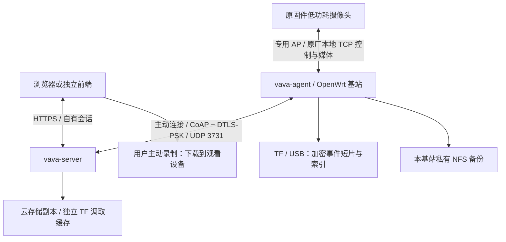

# 组件与职责

## 进程边界

- `vava-agent`：摄像头侧专用网络、临时 AP 配对、三路会话、唤醒与休眠、参数下发、布防计划、事件录像、加密索引、本地留存、NAS 和向 Server 传输。没有业务 HTTP API，不链接 SQLite 或 FFmpeg。
- `vava-server`：认证、基站 ACL、任务与事件数据库、云短片、按需 TF 缓存、媒体适配和 Web API。通过 SDK 连接 Agent，不需要链接 Agent 的业务进程。
- `luci-app-vava-agent`：路由器本地部署/维护界面，使用 OpenWrt 自己的认证和权限。固定助手读状态、配对、改名和发起恢复/删除，不对外开放任意 shell。
- 浏览器前端：基站选择、配置草稿、媒体播放、自动画质、抓图与本机录像。可单独部署；业务权限始终由 Server 校验。
- `myvava-sdk`：控制、事件、文件和实时媒体的自有业务协议，底层为 CoAP / DTLS-PSK；`shared` 为共用解析、协议和媒体封装。

## 两段不同的网络

原摄像头通过专用 AP 连接基站，使用 `172.26.168.1/16` 及控制 TCP 16154、媒体 TCP 18154、保活 TCP 20154；基站另处理 UDP 唤醒。配对网络遵循原固件兼容规则。它们没有被改成自有 UDP，也不依赖原厂账号、域名或 PPCS。

Agent 主动连接用户配置的 Server 域名/IP和 UDP 端口（默认 3731），每台基站使用独立 PSK。握手、重连、事件确认、可靠文件提交和实时帧分别管理。1200 字节是 DTLS 路径 MTU 配置，不是列表或文件总大小上限；应用分块、批量结果与重组各自有界。

浏览器通过 HTTP(S) 接收 Server 的 MP4 / fMP4 媒体，不能直接接普通 UDP。当前没有 WebRTC、ICE、STUN 或 TURN 实现。

## 状态与持久化

| 位置 | 持久内容 | 内存内容 |
| --- | --- | --- |
| Agent 状态目录 | 配对登记、名称、期望配置、布防计划、NAS 设置、恢复/删除进度 | TCP 连接、心跳、电量、充电、实时报告、观看租约、媒体队列、下发进度 |
| TF / USB | 加密片段、权威元数据、层级目录与 `vava.idx`、同步任务/收据 | 有界索引缓存、读者与介质代次 |
| Server | 用户、设备授权、任务、事件、文件策略、云片段和调取对象 | DTLS 连接、观看与媒体重组状态 |
| 浏览器 | 自有会话凭据按客户端策略保存 | 配置草稿、最后观看封面、有界播放缓冲、未完成本机录制 |

心跳、电量与状态轮询不写 Agent Flash。配置只有实际变更时才提交；原子文件写入与 revision 保护的是基站保存，不代表摄像头硬件事务。

## 控制与低功耗

命令携带基站 boot、Server epoch、请求键；摄像头操作还绑定 SN、槽位和配置 revision。未知结果不自动当作失败重放；重连后历史回显不当作当前生效证明。

摄像头不是 24 小时推流设备。按需观看或事件唤醒；停止观看释放对应需求，有其他消费者时不强行休眠。工作模式决定灵敏度，计划决定是否布防；事件录像长度与直播观看时长分开。实时观看没有固定 120 秒截止。

存储 I/O、可靠上传、NAS 和媒体工作线程与摄像头主事件循环隔离；有界队列、租约和超时限制资源占用，但不保证故障磁盘或不可中断 NFS I/O 一定能立即终止。具体上限和验收状态见 [功能状态](FEATURES.md)、[存储](STORAGE.md) 与 [验证](VALIDATION.md)。
